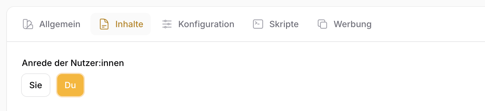
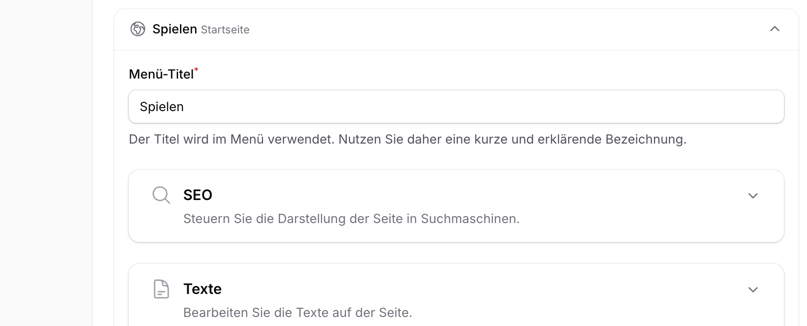

# Inhalte

In der Bearbeitungsmaske einer Publikation verwalten Sie über den Tab _Inhalte_ die **Seiten und die Ansprache** Ihrer Publikation.
Über den Bereich **FAQs** können Sie ergänzend **häufig gestellte Fragen** anlegen, die auf der Hilfe-Seite angezeigt werden.

---

## Ansprache

Über die Ansprache legen Sie fest, ob Ihre Nutzer:innen **geduzt** oder **gesiezt** werden.
Diese Einstellung wirkt sich auf **alle systemgenerierten Texte** innerhalb Ihrer Publikation aus.

---

## Seiten

Jede Publikation verfügt über eine Reihe von **Seiten**, die je nach Rätsel und angebundener [Authentifizierungs-Schnittstelle](./sso) variieren können.
Je nach Seitentyp stehen unterschiedliche Einstellungen zur Verfügung.

### Menütitel

Jede Seite hat einen **Menütitel**, der in der Navigation Ihrer Publikation angezeigt wird.
Sie können den Menütitel jederzeit anpassen.

### Zugangsbeschränkung

Für jede Seite können Sie festlegen, ob sie **freigegeben** oder **gesperrt** ist. Gesperrte Seiten werden nicht angezeigt und können nicht aufgerufen werden.

Ist eine [SSO](./sso) angebunden, stehen zusätzliche Optionen zur Verfügung:

- **Alle** — die Seite ist für alle Nutzer:innen zugänglich
- **Angemeldet** — nur eingeloggte Nutzer:innen haben Zugriff
- **Bestimmter Status** — nur Nutzer:innen mit einem bestimmten Status (z. B. Abonnent:innen) haben Zugriff

> [!INFO]
> Nicht alle Seiten können gesperrt werden. Die Startseite ist beispielsweise immer aktiv.

### Externer Link

Einige Seiten können als **externer Link** konfiguriert werden. In diesem Fall wird der Menüeintrag nicht auf eine Unterseite Ihrer Publikation verweisen, sondern auf eine **externe URL**.

### Texte

Für Seiten, die eigene Inhalte unterstützen, steht ein **Rich-Text-Editor** zur Verfügung.
Damit können Sie Texte mit **Formatierungen**, **Überschriften**, **Listen**, **Links**, **Bildern** und weiteren Elementen gestalten.

Je nach Seitentyp hat der Inhalt eine unterschiedliche Bedeutung:

- **Startseite** — der Text erscheint in einem Layer, der das Spielprinzip erklärt (siehe [Layer der Startseite](#layer-der-startseite))
- **Hilfe-Seite** — der Inhalt dient als Einleitung vor den [FAQs](#faqs)
- **Login / Registrierung** — der Inhalt wird über dem jeweiligen Formular dargestellt
- **Impressum / Datenschutz** — der Inhalt bildet die rechtlichen Texte

### Layer der Startseite

Der Text der Startseite heißt im Editor **Layer**. Er erscheint nicht auf der Seite selbst, sondern in einem Fenster über dem Rätsel:

- **automatisch**, solange Nutzer:innen noch kein Rätsel gespielt haben und nicht angemeldet sind
- **auf Wunsch** über das Hilfe-Symbol im Kopf der Publikation, sofern Sie keine [FAQs](#faqs) angelegt haben – mit FAQs führt das Symbol zur Hilfe-Seite

Ist kein Text hinterlegt, öffnet sich kein Layer. Unter dem Text ergänzt die Publikation automatisch eine kurze Übersicht der Vorteile (etwa Archiv und Spielstand-Speicher) und den Button *Start*.

Welche Seite die Startseite ist, hängt vom Rätsel ab. Bei **Sudoku** ist es die Schwierigkeitsstufe **Leicht**: Dort pflegen Sie den Layer.

### SEO

Für jede aktive Seite können **SEO-Einstellungen** vorgenommen werden:

- **SEO-Titel** — der Titel, der in Suchmaschinen angezeigt wird
- **Beschreibung** — die Meta-Beschreibung für Suchmaschinen
- **Index** — legt fest, ob die Seite von Suchmaschinen indexiert werden soll
- **Follow** — legt fest, ob Suchmaschinen den Links auf der Seite folgen sollen

Weitere Informationen finden Sie unter [SEO](./seo).

---

## FAQs

FAQs werden auf der **Hilfe-Seite** Ihrer Publikation angezeigt. Sie können beliebig viele FAQs anlegen, bearbeiten und per **Drag & Drop** sortieren.

### FAQ erstellen

Jede FAQ besteht aus einer **Frage** und einer **Antwort**. Die Antwort wird über einen **Rich-Text-Editor** verfasst und kann Formatierungen, Links und Bilder enthalten.

### Entwurf und Veröffentlichen

Eine neue FAQ ist zunächst ein **Entwurf**. Entwürfe erscheinen nicht in Ihrer Publikation, Sie können sie in Ruhe ausarbeiten. Erst wenn Sie eine FAQ **veröffentlichen**, steht sie auf der Hilfe-Seite. Sie können eine veröffentlichte FAQ jederzeit wieder zum Entwurf machen, dann verschwindet sie aus der Publikation.

> [!NOTE]
> Wie jede Änderung erscheint eine veröffentlichte FAQ zuerst mit der nächsten Version im [Testmodus](./setup#test). Ist Ihre Publikation live, gelangt sie mit der nächsten [Synchronisation](./setup#nicht-synchronisiert) dorthin.

### Kategorien

Mit **Kategorien** gliedern Sie die Hilfe-Seite in Abschnitte, etwa „Spielregeln“ oder „Konto“. Die Kategorien legen Sie für jede Publikation selbst an und bringen sie in die gewünschte Reihenfolge.

Auf der Hilfe-Seite erscheint jede Kategorie als **Zwischenüberschrift** mit ihren FAQs darunter. FAQs ohne Kategorie stehen ganz oben, ohne eigene Überschrift. Solange Sie keine Kategorien verwenden, bleibt die Hilfe-Seite eine einfache Liste.

Eine Kategorie lässt sich direkt verlinken: `/hilfe#konto` führt zur Kategorie „Konto“. Wird eine Kategorie gelöscht, bleiben ihre FAQs erhalten und stehen danach ohne Kategorie oben.

### Adresse einer FAQ

Jede FAQ hat einen **Slug**, der aus der Frage entsteht und den Sie anpassen können. Über ihn ist die FAQ direkt erreichbar:

- `/hilfe#q-{slug}` öffnet die Hilfe-Seite und klappt die Frage auf, zum Beispiel `/hilfe#q-abo-kuendigen`
- `/hilfe/{slug}` führt zur eigenen Seite der FAQ, wenn sie [als eigene Seite](#faq-als-eigene-seite) veröffentlicht ist

Ältere Links mit einer Nummer, etwa `/hilfe#q-3`, öffnen weiterhin die FAQ an dieser Position.

> [!WARNING]
> Ändern Sie den Slug einer FAQ, funktionieren Links **von außen** auf die bisherige Adresse nicht mehr, etwa aus einem Newsletter oder von Ihrer Website. Interne Links innerhalb Ihrer Publikation passen sich dagegen von selbst an.

### Interne Links

In der Antwort einer FAQ und im Inhalt Ihrer [Seiten](#seiten) können Sie auf **andere FAQs und Seiten Ihrer Publikation** verlinken, ohne deren Adresse zu kennen. Sie wählen das Ziel einfach aus einer Liste aus.

- Zur Auswahl stehen veröffentlichte FAQs und aktive Seiten. Bei Seiten, die nur Angemeldete oder bestimmte Nutzer:innen sehen, ist das in der Auswahl vermerkt.
- Ein Link auf eine FAQ führt zu ihrer eigenen Seite oder, ohne eigene Seite, zur Hilfe-Seite mit aufgeklappter Frage.
- Interne Links öffnen sich ohne Neuladen innerhalb der Publikation, auch wenn sie [eingebettet](./setup#iframe-script) ist.
- Ändert sich die Adresse des Ziels, stimmt der Link automatisch wieder.
- Wird das Ziel gelöscht, deaktiviert oder wieder zum Entwurf, bleibt an der Stelle der Text stehen, ohne Link.

### FAQ als eigene Seite

Eine FAQ kann optional als **eigene Seite** veröffentlicht werden. In der Hilfe-Seite erscheint dann nur der Anfang der Antwort mit einem Link auf die vollständige Seite.

Dabei werden folgende Felder verfügbar:

- **Button-Label**: der Text des Links, über den Nutzer:innen von der Hilfe-Seite zur FAQ-Seite gelangen
- **SEO-Einstellungen**: Titel und Beschreibung für Suchmaschinen

> [!INFO]
> FAQ-Seiten eignen sich besonders für ausführliche Antworten, die den Rahmen der Hilfe-Seite sprengen würden, und können gezielt für Suchmaschinen optimiert werden.
